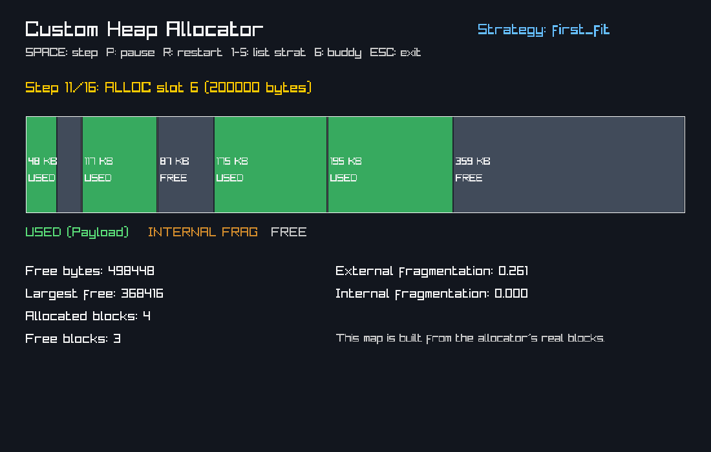
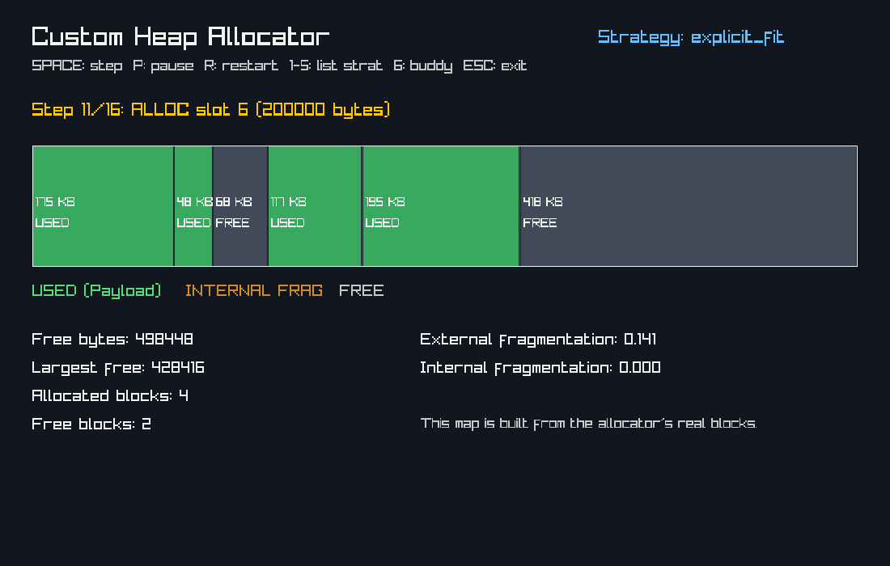
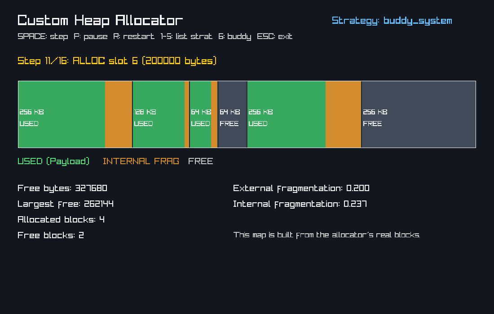
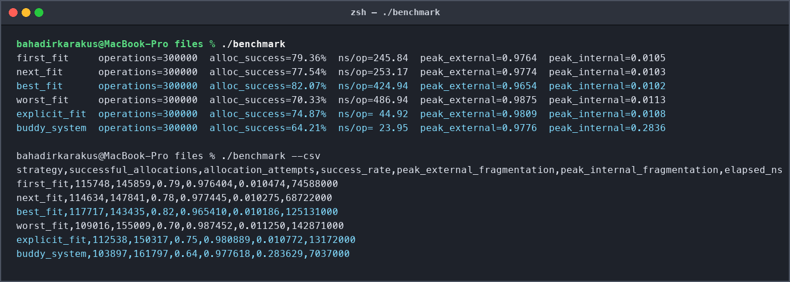
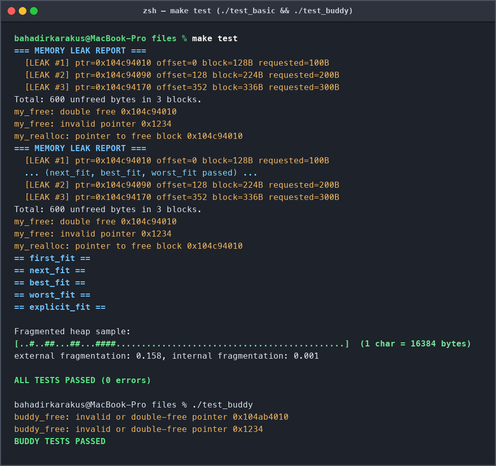
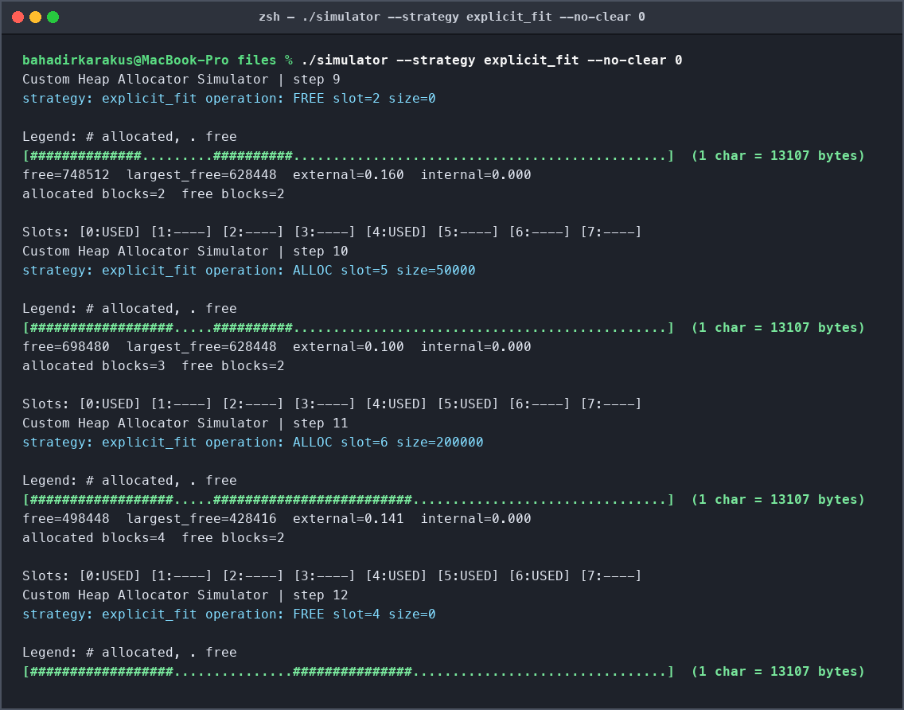

# Custom Heap Memory Allocator & Visualizer in C11


A high-performance, thread-safe user-space dynamic memory management library (`liballocator.a`) and real-time heap fragmentation visualizer built from scratch in **C11** for **Operating Systems** research and systems programming.

Rather than relying on `libc`'s `malloc`, this allocator requests a raw **1 MiB (`2^20` bytes) virtual memory arena** directly from the OS kernel via `mmap` and manages block splitting, immediate $O(1)$ coalescing, alignment, and reuse across **two complete allocator architectures** and **six placement strategies**.

---

## Visual Previews

### Real-Time Raylib 2D Heap Visualizer (`gui_simulator`)
Interactive 60 FPS visualization of a $64\times 64$ grid ($4,096$ cells $\times 256\,\text{B} = 1\,\text{MiB}$ arena) showing live **Allocated Blocks** (blue), **Internal Fragmentation / Padding Waste** (orange), and **Free Blocks** (dark gray):

| Implicit First-Fit (`[1]`) | Explicit Free List (`[5]`) | Binary Buddy System (`[6]`) |
| :---: | :---: | :---: |
|  |  |  |

---

## Key Features

### 1. Boundary-Tag List Allocator (`allocator.c`)
- **Five Placement Strategies:**
  - `FIRST_FIT` — Scans from `heap_start` and selects the first free block with sufficient capacity.
  - `NEXT_FIT` — Resumes the search from the `rover` pointer left by the previous operation.
  - `BEST_FIT` — Exhaustively scans for the tightest-fitting block (early-exits on exact match) to minimize external fragmentation.
  - `WORST_FIT` — Selects the largest available free block.
  - `EXPLICIT_FIT` — Maintains an intrusive **doubly-linked LIFO free list** (`prev`/`next` embedded inside free block headers/payloads with **0 bytes of extra overhead**), reducing allocation search from $O(N_{\text{all}})$ to $O(N_{\text{free}})$ and achieving a **5.6x speedup** over implicit First-Fit.
- **Immediate $O(1)$ Bidirectional Coalescing:** Knuth boundary tags (header + footer) allow merging both physical neighbors in constant time on every `my_free` and shrinking `my_realloc`.
- **Smart In-Place `my_realloc`:**
  - **Shrinking:** Splits the trailing remainder in place and immediately coalesces it with any free right neighbor—zero `memcpy`.
  - **Expanding:** Absorbs an adjacent free right neighbor in place when the combined capacity suffices.
- **Arbitrary Power-of-Two Alignment (`my_aligned_alloc`):** Carves out leading padding as an independent free block to satisfy arbitrary power-of-two alignments ($32, 64, 128, 256, 4096\,\text{B}$).
- **Memory Safety & Diagnostics:**
  - Double-free and invalid/unaligned pointer detection (`err_count`).
  - Active memory leak reporter (`allocator_report_leaks`).
  - Full heap invariant verifier (`allocator_check`).
  - Recursive `pthread_mutex_t` synchronization for multi-threaded workloads.

### 2. Binary Buddy System Allocator (`buddy_allocator.c`)
- **Power-of-Two Orders ($2^5 = 32\,\text{B}$ to $2^{20} = 1\,\text{MiB}$):** Maintains 16 per-order singly-linked free lists (`free_lists[5..20]`).
- **Bitwise-XOR Buddy Arithmetic:** Computes the unique buddy address in $O(1)$ hardware instructions via `offset ^ (1 << order)` and recursively splits/merges in $O(\log N)$ time.
- **Compact 16-Byte Header:** Guarantees strict 16-byte ABI payload alignment across all orders.
- **In-Place Buddy Reallocation:** Supports order-halving splits on shrink and right-buddy absorption on grow.

---

## Memory Block Layout

### Boundary-Tag List Block (`allocator.c`)
Every block size is a multiple of **16 bytes** ($\ge 32\,\text{B}$). Because the lowest 4 bits of the size are always `0000`, bit `0` encodes the `allocated` flag:

```text
+-----------------------------------------------------------------------+
| Allocated Block (Overhead = 24 Bytes, Payload 16-Byte Aligned)        |
+----------------------+-----------------------+------------------------+
| Header (16 Bytes)    | Payload (N * 16 B)    | Footer (8 Bytes)       |
|  - size | alloc (8B) |  User Data            |  - size | alloc (8B)   |
|  - requested    (8B) |  (16-byte aligned)    |                        |
+----------------------+-----------------------+------------------------+

+-----------------------------------------------------------------------+
| Free Block in EXPLICIT_FIT (Same 32B Min Block, Zero Extra Overhead)  |
+----------------------+-----------------------+------------------------+
| Header (16 Bytes)    | Payload Area (>= 8B)  | Footer (8 Bytes)       |
|  - size | 0     (8B) |  - next_free ptr (8B) |  - size | 0     (8B)   |
|  - prev_free    (8B) |  - unused slack       |                        |
+----------------------+-----------------------+------------------------+
```

### Binary Buddy Block (`buddy_allocator.c`)
```text
+-------------------------------+---------------------------------------+
| Buddy Header (16 Bytes)       | Payload (2^k - 16 Bytes)              |
|  - next ptr      (8 Bytes)    |  User Data (Strictly 16B Aligned)     |
|  - requested     (4 Bytes)    |                                       |
|  - order (5..20) (1 Byte)     |                                       |
|  - is_free       (1 Byte)     |                                       |
|  - magic (0xB0D1)(2 Bytes)    |                                       |
+-------------------------------+---------------------------------------+
```

---

## Benchmark & Fragmentation Analysis

Evaluated over **300,000 deterministic operations** (`xorshift32` seed `0xC0FFEE`, 512 active slots, allocation sizes $1\,\text{B} \dots 8,192\,\text{B}$, 75% `malloc`/`free`, 25% `realloc`) timed via `clock_gettime(CLOCK_MONOTONIC)`:



| Strategy | Allocation Success Rate | Latency (`ns/op`) | Peak External Frag. ($F_{\text{ext}}$) | Peak Internal Frag. ($F_{\text{int}}$) | Total Time (`ms`) |
| :--- | :---: | :---: | :---: | :---: | :---: |
| **`first_fit`** | 79.36% | 254.21 ns | 0.9764 | 0.0105 | 76.26 ms |
| **`next_fit`** | 77.54% | 237.87 ns | 0.9774 | 0.0103 | 71.36 ms |
| **`best_fit`** | **82.07%** | 429.47 ns | **0.9654** | **0.0102** | 128.84 ms |
| **`worst_fit`** | 70.33% | 492.00 ns | 0.9875 | 0.0113 | 147.60 ms |
| **`explicit_fit`** | 74.87% | **44.92 ns** | 0.9809 | 0.0108 | 13.48 ms |
| **`buddy_system`** | 64.21% | **24.07 ns** | 0.9776 | 0.2836 | **7.22 ms** |

### Key Takeaways
- **Best Space Utilization (`best_fit`):** Achieves the highest allocation success rate (**82.07%**) and lowest external fragmentation (**0.9654**) at the cost of $O(N_{\text{all}})$ full-heap scans.
- **Best List-Allocator Speed (`explicit_fit`):** Traversing only free blocks via the doubly-linked free list cuts per-operation latency from **254.21 ns** down to **44.92 ns** (**5.6x faster**).
- **Fastest Overall (`buddy_system`):** Direct order indexing and bitwise-XOR coalescing reach **24.07 ns/op** (**10.5x faster** than First-Fit), trading internal fragmentation (~28.36% due to power-of-two rounding) for deterministic $O(\log N)$ latency.

---

## Automated Verification & Terminal Simulator

| Correctness & Stress Suite (`./test_basic` & `./test_buddy`) | Interactive CLI Heap Map (`./simulator`) |
| :---: | :---: |
|  |  |

The automated test suite verifies:
1. Basic allocation, data integrity, and freeing across all 5 list strategies + Buddy System.
2. Exact boundary-tag coalescing across all 4 neighbor cases (none, right-only, left-only, both).
3. `my_calloc` zero-initialization and overflow protection (`SIZE_MAX / 2` multiplication guard).
4. `my_realloc` shrinking (in-place split), growing (in-place right-neighbor merge & fallback copy), and edge cases (`NULL`, `size == 0`).
5. 16-byte default alignment and `my_aligned_alloc` ($32, 64, 128, 256, 4096\,\text{B}$).
6. Double-free, NULL, stack-pointer, and interior-pointer safety checks.
7. **20,000-step randomized stress test** with byte-for-byte payload verification and `allocator_check()` invariant validation after every operation.
8. **4-thread x 2,500-op `pthread` concurrency stress test** (10,000 concurrent operations).

---

## Quick Start

### Prerequisites
- C11 compiler (`clang` or `gcc`)
- `make`
- *(Optional, for GUI)* `raylib` (`brew install raylib` on macOS)

### Build & Run
```bash
# Build static library (liballocator.a) and all binaries
make

# Run full unit, stress, and multithreaded test suites
make test

# Run 300,000-op benchmark across all 6 strategies and export results.csv
make bench

# Run with AddressSanitizer + UndefinedBehaviorSanitizer
make asan
```

### Running the Simulators
```bash
# 1. Interactive CLI Simulator (64-bucket ASCII heap map)
./simulator --strategy explicit_fit
# Inside the prompt: malloc 4096 | calloc 10 256 | realloc 0 8192 | align 256 1024 | free 0 | leaks | map | stats

# Scripted CLI Demo
./simulator --strategy best_fit --demo

# 2. Real-Time 60 FPS Raylib GUI Visualizer
./gui_simulator
```

#### GUI Keyboard Controls
| Key | Action |
| :---: | :--- |
| `1` - `5` | Switch live to `First-Fit`, `Next-Fit`, `Best-Fit`, `Worst-Fit`, or `Explicit-Fit` |
| `6` | Switch live to the `Binary Buddy System` |
| `SPACE` | Inject a random `malloc` / `free` / `realloc` burst |
| `P` | Pause / Resume continuous simulation |
| `C` | Clear all active allocations and watch full arena coalescing |

---

## Public C API (`allocator.h` & `buddy_allocator.h`)

```c
#include "allocator.h"
#include "buddy_allocator.h"

/* Boundary-Tag List Allocator */
int    allocator_init(strategy_t strategy);
void   allocator_destroy(void);
void  *my_malloc(size_t size);
void   my_free(void *ptr);
void  *my_realloc(void *ptr, size_t size);
void  *my_calloc(size_t nmemb, size_t size);
void  *my_aligned_alloc(size_t alignment, size_t size);
size_t my_usable_size(void *ptr);

void   allocator_get_stats(allocator_stats_t *out);
void   allocator_dump(void);
int    allocator_check(void);
size_t allocator_report_leaks(void);

/* Binary Buddy System Allocator */
int    buddy_init(void);
void   buddy_destroy(void);
void  *buddy_malloc(size_t size);
void   buddy_free(void *ptr);
void  *buddy_realloc(void *ptr, size_t size);
void  *buddy_calloc(size_t nmemb, size_t size);
int    buddy_check(void);
```

---

## Author

**Fatih Bahadır Karakuş**
- GitHub: [@bahadirkarakus](https://github.com/bahadirkarakus)
